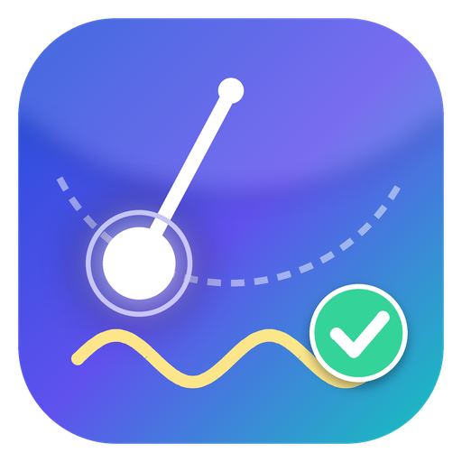

# SciSketch

A desktop (PySide6) science lab: **verified physics simulation + a live teacher that works offline.**

**Problem:** most educational simulators use naive integrators whose energy silently drifts, so animations look right
while being physically wrong.
**Solution:** every run is checked against a high-precision DOP853 reference (rtol 1e-12). SciSketch reports energy drift,
trajectory error and a verdict (TRUSTWORTHY / USABLE / UNRELIABLE); *Compare all methods* overlays Euler, RK4 and DOP853.

## Features
- **Systems:** nonlinear pendulum, chaotic double pendulum, Kepler orbit, Hénon-Heiles
- **Live teacher (works offline, no API key):**
  - explains your run at *School / Undergraduate / Advanced* level, quoting only numbers measured from the verified simulation
    (exact pendulum period, Kepler laws, chaos sensitivity, ...)
  - **live captions** while the animation plays (turning points, periapsis, section crossings) and optional **speech**
  - *Watch my experiment*: comments after every run; *Next lesson step*: guided experiments; *Suggest an experiment*
  - **Convergence experiment**: measures the real order of Euler (≈1) and RK4 (≈4) on your system
  - **Quiz** generated from your own results; ask it questions in plain language
  - optional **AI teacher** (your SciSketch AI endpoint, streaming) that can also set up simulations; if the AI is
    unreachable the offline teacher answers automatically
- **Save everything** (default folder `Documents/SciSketch`, see *Library* tab):
  - **Images:** PNG / SVG / PDF of the dashboard, clipboard copy, chat as PDF, AI illustrations/diagrams/simulations as SVG/HTML
  - **Videos:** MP4 or GIF of the full animation with live captions (720p-1080p, 24-60 fps), optional **spoken narration**
  - **Documents:** lab report as **Word (.docx), PDF, HTML or Markdown** (setup, verification table, figures, explanation,
    teacher conversation, your notes)
  - **Sessions** (`.sciproj`) to reopen an experiment and its conversation later, CSV data
- **Offline rich rendering:** Markdown, LaTeX (KaTeX), Mermaid, SVG, p5.js and three.js render on your machine from bundled
  libraries (`web/vendor`). No network from the view; p5/three run in sandboxed iframes.
- **Design:** six themes (Ocean, Midnight, Graphite, Sunset, Forest, Light), custom accent colours, text size, responsive layout.

## Run from source
    pip install -r requirements.txt
    python scisketch.py

First launch with AI: *Teacher* tab > **API key...** (stored only on this computer in `~/.scisketch/config.json`, or
`%APPDATA%\SciSketch\config.json` on Windows). `SCISKETCH_KEY` env var also works.

## If the chat / formulas / diagrams do not draw on your PC
1. *Teacher* tab > **Check rendering** prints a diagnostics report (paste it in an issue).
2. *Appearance* > **Chat rendering = Compatible** (default) uses software rendering that works on every PC, virtual machine
   and remote desktop. Restart after changing it.
3. If Chromium cannot start at all, SciSketch switches to a simple built-in view automatically (formulas appear as readable
   text) - the simulation, teacher, quiz and all saving keep working.

Video narration uses your computer's own voices (Windows SAPI, macOS `say`, Linux `espeak-ng`); without one the video is
simply silent. FFmpeg is bundled (via `imageio-ffmpeg`), nothing to install.

## Build the app
    build.bat        # Windows -> dist\SciSketch\SciSketch.exe
    ./build.sh       # Linux/macOS -> dist/SciSketch/
GitHub Actions (`.github/workflows/build.yml`) runs the test-suite, builds Windows, macOS and Linux, runs
`SciSketch --selftest` on each *packaged* build (simulation, teacher, image/document/video export, offline renderer) and uploads
the zips; pushing a tag like `v2.0.0` publishes them as a GitHub Release.

## Tests
    python tests/test_core.py     # physics, verification, teacher numbers vs known results, convergence orders
    python tests/test_export.py   # images, MP4/GIF (+narration), DOCX/PDF/HTML/MD, sessions - files are re-opened and checked
    python tests/test_gui.py      # whole app headless: teacher, quiz, AI route + fallback, saving, themes, responsive layout

Third-party licenses: `web/vendor/*-LICENSE` (p5.js is LGPL-2.1).
